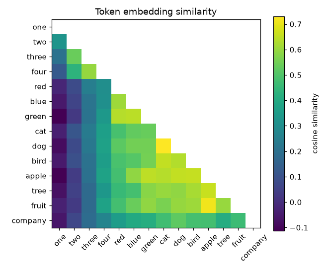
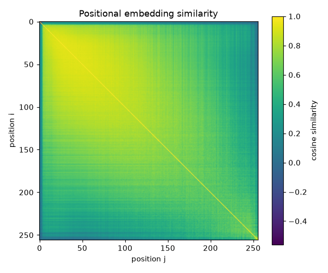
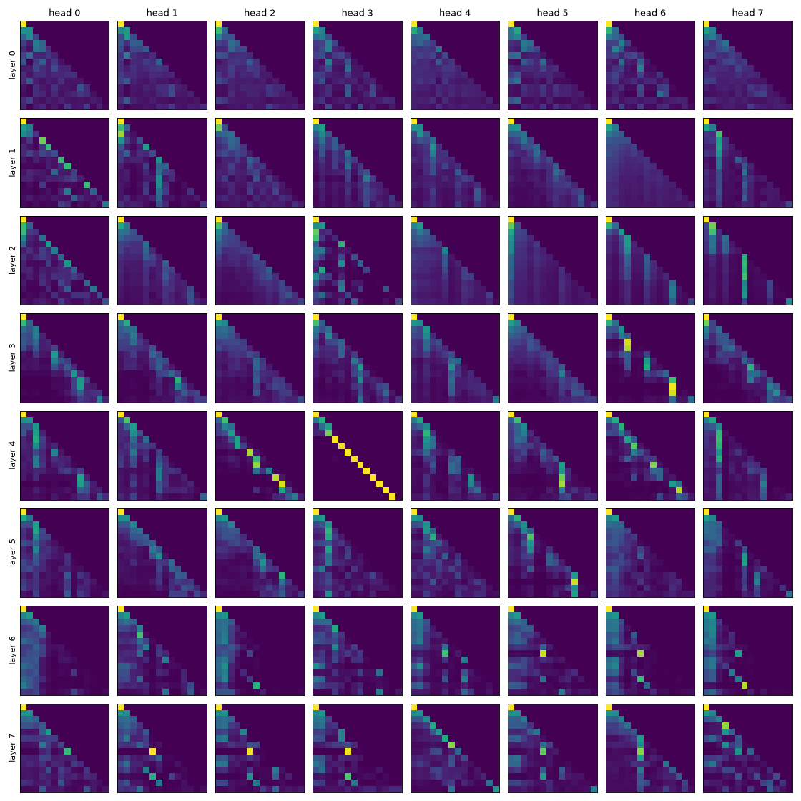
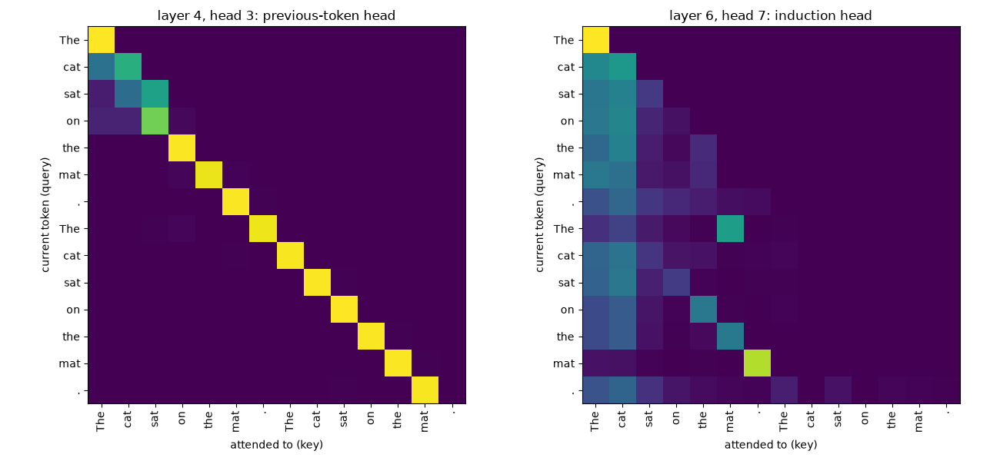

# GPT-2 From Scratch in PyTorch

A modular, end-to-end implementation of the **GPT-2** transformer architecture built from scratch in PyTorch, with a two-stage LLM training pipeline: **Stage 1 Pre-Training** (learning language) and **Stage 2 Supervised Fine-Tuning** (learning Question-Answering). It also includes an analytics notebook for looking inside the trained model.

## Quick Start

### 1. Install Dependencies
```bash
pip install -r install.txt
```
On a GTX 1050 Ti (Pascal), install the CUDA 12.6 torch build noted at the top of `install.txt`.

### 2. Configure Hyperparameters (`meta.py`)
The default preset targets a **GTX 1050 Ti (4 GB, fp32)**: `embed_dim=512`, `seq_len=256`, `n_heads=8`, `n_blocks=8`, `batch_size=8` with `grad_accum=4` (~51M params). The full 124M GPT-2 preset for an A100 is kept commented out in the same file.

### 3. Run Both Stages
```bash
python run_training.py   # pretraining.py, then supertuning.py, each in its own process
```

### 4. Stage 1: Pre-Training (Base Model)
```bash
python pretraining.py
```
- Trains from random weights on **WikiText-103** (general English), mixed with a **20M-token slice of TinyStories** for simple grammar. The data is cached in `wikitext.pt` and `tinystories.pt`.
- **Choosing the data:** change `tinystories_tokens` in `get_pretrain_mix()` (`databuilder.py`). Set it to `0` for WikiText only, or call `get_tinystories()` directly in `pretraining.py` for a TinyStories-only model.
- One epoch, `lr=6e-4`, no dropout, with a held-out validation split. The output is **`gpt2_pretrain.pt`**.

### 5. Stage 2: Supervised Fine-Tuning (Q&A Model)
```bash
python supertuning.py
```
- Formats **Alpaca + Dolly-15k** pairs as `Question: ...\nAnswer: ...<|endoftext|>` and caches them in `alpaca.pt` and `dolly.pt`.
- Masks the question and padding with `-100`, so the loss covers only the answer tokens.
- Loads `gpt2_pretrain.pt` and trains for 5 epochs at `lr=3e-4`, with 5% held out for validation. Each epoch is saved as `gpt2_qa_ep{N}.pt`, and the epoch with the best validation loss as **`gpt2_qa.pt`**.

### 6. Chat With the Model (`test.py`)
```bash
python test.py
```
Interactive Q&A loop that streams each answer and prints its perplexity.

---

## Project Structure

```text
├── meta.py            # Hyperparameters, tokenizer, device
├── model.py           # GPT-2 architecture & generate()
├── databuilder.py     # WikiText / TinyStories pretraining mix, Alpaca + Dolly SFT data
├── train.py           # Shared training loop (AdamW, warmup + cosine LR, grad accumulation, clipping)
├── pretraining.py     # Stage 1: base model
├── supertuning.py     # Stage 2: SFT
├── run_training.py    # Runs both stages back to back
├── test.py            # Interactive inference
├── analytics.ipynb    # Model inspection & plots (see below)
└── install.txt        # Dependencies
```

## Core Highlights

- **Architecture (`model.py`):** causal multi-head self-attention (`scaled_dot_product_attention`), Pre-LayerNorm blocks, GELU MLP, learned positional embeddings, and **weight tying** between the token embedding and the output head. Uses GPT-2-style init with scaled-down residual projections.
- **Training (`train.py`):** AdamW (no weight decay on biases or LayerNorm), linear warmup followed by cosine decay, gradient accumulation, gradient clipping at 1.0, validation every epoch, and best-checkpoint saving.
- **Generation:** temperature, top-k and top-p (nucleus) sampling, live streaming hooks, and perplexity scoring.

---

## Model Analytics (`analytics.ipynb`)

The notebook loads `gpt2_qa.pt` and produces the plots below.

- **Model summary (`torchinfo`):** layer shapes and parameter counts. torchinfo counts the tied embedding and output matrix twice and reports 76.8M. The real count is **51.07M** (`sum(p.numel() for p in model.parameters())`). About half of that is the 50257×512 vocabulary matrix.
- **Token embedding similarity:** cosine similarity between chosen word embeddings. The question is whether related words end up close together.
- **Positional embedding similarity:** cosine similarity between all 256 learned position vectors. The question is whether the model learned a sense of order.
- **Attention patterns:** each head's attention weights, recomputed with forward hooks because `scaled_dot_product_attention` does not return them. The question is which heads have learned specific jobs.

### Token embedding similarity


Semantic groups form clear blocks. The numbers *two/three/four* cluster together, as do the colors and *cat/dog/bird*. *apple–fruit* and *cat–dog* score highest at about 0.7. *company* stands apart from all of them, and *one* is weaker than the other numbers because it is also used as a pronoun ("no one").

### Positional embedding similarity


Similarity fades smoothly with distance from the diagonal, so nearby positions have similar vectors and the model has learned order. Position 0 and the last few positions are distinct from the rest, since they are the sequence boundaries.

### Attention: all heads


The 8 layers × 8 heads are shown for `"The cat sat on the mat. The cat sat on the mat."` Each cell is a T×T map, with the current token as the row and the attended token as the column. Layer 0 heads spread attention broadly. Later layers develop sharp, specialized patterns. The yellow top-left pixel in every map is forced, since token 0 can only attend to itself.

### Attention: specialized heads


- **Layer 4, head 3, previous-token head:** about 88% of each token's attention goes to the token right before it.
- **Layer 6, head 7, induction head:** in the repeated half, each token attends to the token that *followed* its earlier copy. For example, the second "on" attends to the first "the". This copying mechanism is the basis of in-context learning, and it builds on previous-token heads like L4H3.
